<picture>
  <source media="(prefers-color-scheme: dark) and (max-width: 600px)" srcset="assets/profile-dark-mobile.svg">
  <source media="(max-width: 600px)" srcset="assets/profile-light-mobile.svg">
  <source media="(prefers-color-scheme: dark)" srcset="assets/profile-dark.svg">
  
</picture>

I’m a computer science graduate in Coimbra, Portugal, studying for an **MSc in Computer Science & Engineering, specializing in Cybersecurity** at Universidade de Coimbra.

I build tools for my own routines, from tracking meals to moving files between devices and running Minecraft servers. I work on both the applications and the Linux infrastructure behind them.

[Website](https://diogorodrigues.net) · [LinkedIn](https://www.linkedin.com/in/diogor0d) · [All repositories](https://github.com/diogor0d?tab=repositories)

## A few things I’m building

### [PlateOS](https://github.com/diogor0d/plate-os)
**Nutrition tracking, with a review step.** Scan a barcode, photograph a label, or describe a meal. The model extracts the information; code calculates the totals. You confirm what gets logged.

Python · FastAPI · React · PostgreSQL · Offline-first PWA

### [Clipboard Mate](https://github.com/diogor0d/clipboard-mate)
**A shared clipboard you control.** Send text between iPhone, Windows, and macOS through a server you host. Publishing and copying are explicit actions; nothing watches your local clipboard in the background.

TypeScript · Fastify · Electron · SQLite · Apple Shortcuts

### [Media Manager](https://github.com/diogor0d/media-manager)
**The file is too big. The format is wrong.** Download, convert, and compress media on your own server, with output estimates before processing and a history to recover results from.

Python · FastAPI · FFmpeg · Docker · MeTube

### [PaperSpotlights](https://github.com/diogor0d/paper-spotlights)
**Stage lighting, built out of Minecraft.** Build a fixture, aim it with a lens, and turn a clock to dim it. Native light blocks, no client mod, no resource pack.

Java · Paper API · Maven · No runtime dependencies

## Public repository directory

All **30 public repositories**, including coursework, experiments, and **2 forks**. Snapshot: **2026-10-19**. [Browse the live list →](https://github.com/diogor0d?tab=repositories)

<strong>Products & everyday tools</strong> · 12 repositories

| Repository | What’s inside |
| :--- | :--- |
| [attack-shark-api](https://github.com/diogor0d/attack-shark-api) | Local API and lighting dashboard for the Attack Shark X68HE keyboard. |
| [audio-metadata-manager](https://github.com/diogor0d/audio-metadata-manager) | Windows-local workbench for repairing Spotify Local Files metadata, artwork, and audio. |
| [clipboard-mate](https://github.com/diogor0d/clipboard-mate) | Self-hosted clipboard relay for sharing text across iPhone, Windows, and macOS. |
| [codex-window-optimizator](https://github.com/diogor0d/codex-window-optimizator) | Self-hosted console for scheduling Codex tasks and viewing account usage windows. |
| [enrollment-bot](https://github.com/diogor0d/enrollment-bot) | Local visual automation assistant for selecting course schedules in Coimbra’s student portal. |
| [instawatch](https://github.com/diogor0d/instawatch) | Proof-of-concept Instagram feed application for Apple Watch. |
| [lighting-orchestrator](https://github.com/diogor0d/lighting-orchestrator) | Windows-first control plane coordinating RGB lighting, screen ambience, music reactions, and alerts. |
| [media-manager](https://github.com/diogor0d/media-manager) | Self-hosted service for media downloads, conversion, compression, and history. |
| [MoneyMate](https://github.com/diogor0d/MoneyMate) | Experimental personal-finance app built with React and Django. |
| [paper-spotlights](https://github.com/diogor0d/paper-spotlights) | Paper Minecraft plugin enabling player-built stage lighting with vanilla light blocks. |
| [plate-os](https://github.com/diogor0d/plate-os) | Self-hosted nutrition-tracking PWA with reviewable proposals for confirmed food logging. |
| [vinted-assistant](https://github.com/diogor0d/vinted-assistant) | Repository scaffold; no application code published yet. |

<strong>Infrastructure & integrations</strong> · 4 repositories

| Repository | What’s inside |
| :--- | :--- |
| [ciaac-bot](https://github.com/diogor0d/ciaac-bot) | Bot that bridges public Instagram updates into Discord. |
| [ciaac-platform](https://github.com/diogor0d/ciaac-platform) | Modular Paper plugin for CIAAC minigames, progression, minecart control, and local observability. |
| [metube-sidecar](https://github.com/diogor0d/metube-sidecar) | FastAPI job API for MeTube downloads and returning files to authorized callers. |
| [notion-local-mcp](https://github.com/diogor0d/notion-local-mcp) | Windows launcher for Notion’s MCP server with DPAPI-protected token storage. |

<strong>Coursework</strong> · 10 repositories

| Repository | What’s inside |
| :--- | :--- |
| [ex2-poo](https://github.com/diogor0d/ex2-poo) | Java programming exercises. |
| [ficha3-rc](https://github.com/diogor0d/ficha3-rc) | C programming exercises. |
| [projeto-iprp](https://github.com/diogor0d/projeto-iprp) | Python foosball project. |
| [projeto-poo](https://github.com/diogor0d/projeto-poo) | Java command-line financial management system for an object-oriented programming course. |
| [projeto-ppp](https://github.com/diogor0d/projeto-ppp) | C patient and clinical-record management application for a procedural programming course. |
| [projetoatd](https://github.com/diogor0d/projetoatd) | MATLAB live scripts and project reports. |
| [projetorc](https://github.com/diogor0d/projetorc) | Reliable data-transfer protocol over UDP, implemented in C for a networking course. |
| [projetosd](https://github.com/diogor0d/projetosd) | Distributed web search engine with parallel crawlers, inverted index, browser interface, and CLI. |
| [projetoSO](https://github.com/diogor0d/projetoSO) | Concurrency-focused blockchain simulation exploring operating-system processes, IPC, and synchronization. |
| [tp2-ti](https://github.com/diogor0d/tp2-ti) | Python compression project with gzip and Huffman-tree code. |

<strong>Profile, website & forks</strong> · 4 repositories

| Repository | What’s inside |
| :--- | :--- |
| [diogor0d](https://github.com/diogor0d/diogor0d) | This profile, its README, and its graphics. |
| [diogor0d.github.io](https://github.com/diogor0d/diogor0d.github.io) | GitHub Pages website source. |
| [opencode](https://github.com/diogor0d/opencode) fork | Fork of OpenCode, an open-source AI coding agent. |
| [uYouEnhanced](https://github.com/diogor0d/uYouEnhanced) fork | Fork of uYouEnhanced, an iOS YouTube tweak project. |

